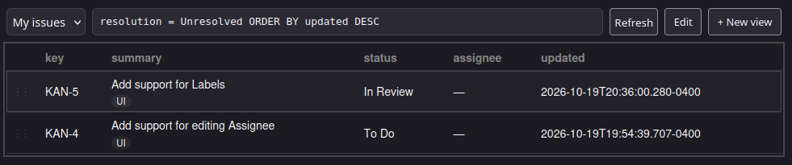
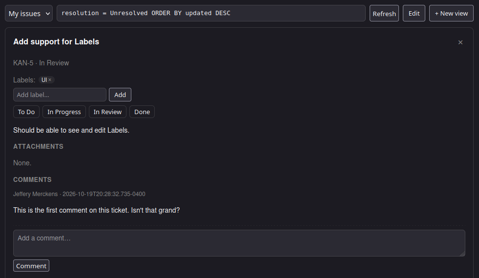

# jira-view

A local, single-user front-end for Jira Cloud — saved views, custom columns,
and drag-and-drop ordering that stays on your machine.

This started as a toy project to learn Gleam, Lustre, Wisp/Mist and SQLite, and
to make my own Jira workflow a little nicer. It is shared mainly so I can use it
from another machine. Issues and small PRs are welcome, but there is no roadmap,
support, or stability promise.

> Not affiliated with or endorsed by Atlassian. Jira is a trademark of Atlassian.

## What it does

- Saved views, each with its own JQL query or board source, columns, and private
  ordering.
- Drag-and-drop row ordering (or keyboard shortcuts) layered over Jira's sort;
  new issues append at the end.
- Inline issue detail with summary editing, transitions, assignee, comments
  with basic formatting, work logs, labels, flag toggling, attachment previews,
  and an Open in Jira link. Flagged issues get a faint red row tint in the
  list.
- Auto/light/dark color-scheme toggle; Auto follows the operating system.
- Talks to Jira Cloud through a local proxy; credentials stay in `.env` and
  never reach the browser.
- Local SQLite database for views and ordering. No telemetry.

## Screenshots

**List view**



**Issue detail**



## Requirements

- Gleam 1.19+ and Erlang/OTP 27+ (developed on OTP 29).
- Node.js 20+ only if you want to rebuild or test the UI.
- A Jira Cloud site and an API token. Jira Server/Data Center is not supported.

## Run

1. Copy the example config and fill it in:

   ```sh
   cp .env.example .env
   ```

   Create an API token at
   <https://id.atlassian.com/manage-profile/security/api-tokens>. Use a
   dedicated or scoped token if your Jira plan allows it.

2. Start the app:

   ```sh
   ./dev.sh
   ```

   Then open <http://127.0.0.1:8787/>. `dev.sh` rebuilds the UI when esbuild
   is available and otherwise uses the committed `assets/app.js`.

Configuration is read from the environment on each request:

| Variable | Required | Notes |
| --- | --- | --- |
| `JIRA_EMAIL` | yes | The email associated with the API token. |
| `JIRA_API_TOKEN` | yes | Stored only in `.env`. |
| `JIRA_BASE_URL` | yes | Must be `https://`, without a trailing slash. |
| `JIRA_VIEW_PORT` | no | Defaults to `8787`. |
| `JIRA_VIEW_DB` | no | Defaults to `jira-view.db` in the current directory. |
| `JIRA_FLAGGED_FIELD` | no | Id of the custom field that implements Flagged. Discovered by name by default. |
| `JIRA_FLAGGED_VALUE` | no | Option value written when flagging. Defaults to the field's first allowed option (usually `Impediment`). |

`.env`, the SQLite database, and test artifacts are gitignored.

## Views & ordering

- Drag rows by the `⋮⋮` handle; each view's order is saved to the local
  `view_issues` table on every drop and re-applied over Jira's sort on the
  next fetch.
- Keyboard: `j`/`k` move the focus cursor, `Shift+j`/`Shift+k` relocate the
  focused row, `Enter` opens its detail in place of the list, `Esc` returns
  to the list.
- Views: pick one in the toolbar, `+ New view` to create, `Edit` to rename,
  re-source (JQL or a board's issues), choose columns, or delete. The JQL box
  + Refresh run the edited query without saving it; saving is explicit.
- In the detail panel: edit the summary inline, use transition buttons
  (required `resolution` fields get a picker, others are refused with Jira's
  field list), pick an assignee from Jira's assignable users (including
  unassign), toggle Flagged, add comments, log work, and add/remove label chips
  — all optimistic, undone by a refetch on failure. Comments accept basic
  formatting: blank lines separate paragraphs, `- ` makes bullets, `1. ` makes
  numbered lists, and `# ` makes headings. Richer formatting and description
  edits stay in Jira; the detail header links there. Attachments render inline
  (or download) through the local proxy. List rows show labels under the
  summary; flagged rows also get a faint red tint.
- The native Flagged field is discovered per site by its name. If your site
  uses a renamed field or the write fails with “not on the appropriate
  screen”, set `JIRA_FLAGGED_FIELD` and/or add Flagged to the issue Edit
  screen.
- A view is capped at 2000 issues.

## Security & limitations

- The server binds `127.0.0.1` and rejects non-local `Host` headers. Do not
  expose it through a reverse proxy or bind it to `0.0.0.0`.
- The Jira email and API token live in `.env` on your machine. The browser only
  talks to local `/jira/*` endpoints, which proxy Jira with those credentials.
- Writes require `Content-Type: application/json`, which blocks simple
  cross-site form posts.
- Single user. There is no login, multi-user support, or hosted mode.
- Jira Cloud only; Jira Server/Data Center is not supported.

## Development

```sh
gleam test                                  # backend tests (Erlang target)
(cd shared && gleam test)                   # shared tests
(cd ui && gleam test --target javascript)   # UI tests (needs npm install)
npm --prefix ui install                     # once, for the UI build and tests
./build.sh                                  # rebuild assets/app.js
```

`assets/app.js` is committed because the backend serves it as-is. After UI
changes, run `./build.sh` and commit the rebuilt bundle.

## License

MIT — see [LICENSE](LICENSE). Third-party components bundled into
`assets/app.js` are listed in [THIRD_PARTY_NOTICES.md](THIRD_PARTY_NOTICES.md).

Jira is a trademark of Atlassian. This project is not affiliated with or
endorsed by Atlassian.
